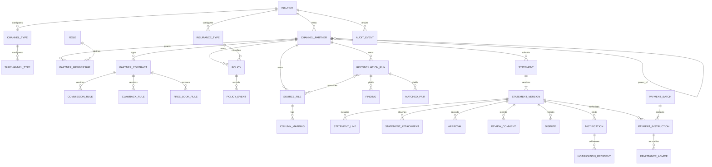

# 23 — Partner commission reconciliation: architecture decision record

**Status: proposed; implementation and production use blocked.**

**Date:** 2026-10-27

**Scope:** insurer-owned partner reconciliation, statement review and payment hand-off.

**Related:** [existing partner-portal contract](20-PARTNER-PORTAL.md), [production roadmap](22-PARTNER-PRODUCTION-ROADMAP.md), [delivery plan and open decisions](24-RECONCILIATION-DELIVERY-PLAN.md), [ReconIQ integration map](25-RECONIQ-INTEGRATION-MAP.md).

This record is a design, not a claim that its database, endpoints, feature flag, screens or controls exist. The requested financial rules and the right to adapt the supplied reference need confirmation. Until then, **no entitlement, free-look, clawback, payable or payment calculation is authorized by this record**. The existing partner portal remains a prototype; it is not changed by this design.

## Context and findings

The requested lifecycle is partner-owned preparation followed by **independent insurer verification**, insurer approval, and a controlled AP hand-off. Insurer, partner and sub-partner ownership must survive every document, decision and payment reference. A statement's financial history may never be rewritten after submission.

The target is already a TypeScript modular monolith with a React partner workspace; a second FastAPI application would duplicate its UI, identity and domain boundaries. The inspected baseline is:

| Concern | What actually exists | Gap for this feature |
| --- | --- | --- |
| Runtime/API | Plain Node HTTP server, `/api` dispatcher, route catalogue, request guard and JSON error conventions (`src/server/main.ts`, `src/core/routes.ts`, `src/core/route-catalogue.ts`). | The runtime is a process-local demo world; new routes would need persistent transactions and object authorization. |
| UI | React 19/Vite; `src/ui/partner-portal.tsx`, `partner-portal.css`, `api.ts`, and the label registry. | Reuse the shell and labels; the offline demo must not accidentally enable live reconciliation. |
| Identity/authorization | Environment-configured bearer tokens map to a name and roles in `src/server/auth.ts`. Partner/sub-channel claims are checked by `src/core/routes.ts`. Open demo mode exists. | There is **no integrated production IdP/SSO** or provisioned insurer membership, and demo/internal roles are not insurer-scoped. The UI role selector is not authority. |
| Tenancy | `PartnerScope` contains partner, channel and optional sub-channel. `ChannelPartner` has no parent-partner reference; channel/sub-channel kinds are TypeScript unions (`src/core/channels.ts`). | No durable insurer boundary, descendant permissions, partner hierarchy or configuration-driven kind model. Existing scope checks are insufficient for this feature. |
| Database/migrations | Postgres 16/PgBouncer deployment topology is documented; `src/core/persistence.ts` is a snapshot codec. | **No runtime SQL driver, database schema or SQL migration runner** exists. A snapshot and a deployment example are not transactional persistence. |
| Money | `src/core/money.ts` uses currency-specific bigint minor units and exact rational operations. | Rates, unrounded intermediates, FX and rounding need an approved exact-decimal representation and explicit policy; do not convert amounts to JS `number`. |
| Commission | `src/core/partner-portal.ts` records a prototype accrual, statement comparison and external-disbursement reference. `src/core/batch.ts` has demo schedules and clawback examples. | Both are in memory; their monthly period, demo rates and clawback assumptions are not approved rules for this workflow. Neither sends a payment. |
| Files/jobs/notifications | Generic in-memory ingest, an in-memory batch registry, a mail transport and email route configuration exist. The Gmail transport can send mail when configured. | No protected document/blob service, malware gate, durable job queue, transactional delivery outbox or reconciliation notification directory is present. A prepared email or dry run is not a delivery. |
| Audit/idempotency | `src/core/idempotency.ts` and several in-memory/hash-chained registers demonstrate relevant interfaces. | They do not provide durable, concurrent, append-only reconciliation audit and idempotency. |
| Tests/CI | Vitest, TypeScript strict mode, ESLint, Playwright tools and `.github/workflows/ci.yml` run on Node 22. | The workflow has no Postgres/RLS, object-storage or production identity integration tests. |

The linked archive was read-only reference material: `uaebrokers-main.zip`, SHA-256 `53abb55c0e76956c518383b33d3c007f5c488cf29d1f884641abf2c14b943031`. Its `LICENSE` is **GPL-3.0**; this repository's `LICENSE` is proprietary/all-rights-reserved. Direct translation or copying may carry license obligations. Obtain the copyright holder's written authorization for a compatible license or legal approval of an alternative before importing or adapting code, tests or fixtures. This record does not decide the legal outcome.

## Decision

1. **Extend the existing application**, using domain ports rather than a second web app. Add a disabled-by-default, server-enforced `PARTNER_COMMISSION_RECONCILIATION_ENABLED` feature gate (proposed name). No new surface or mutation, including an offline dispatcher or a background worker, may bypass it. Enabling it must additionally require verified identity, durable storage, configured rules, and the release approvals in the plan. The flag is not implemented yet.
2. **Establish the durable foundation first.** Add a reviewed Postgres driver and migration runner, primary-backed transactions, scoped repositories and RLS, private object storage, an audit journal and a transactional outbox. Existing in-memory components can inform interfaces but must not be the system of record. Keep the platform's proposed PgBouncer transaction-pooling constraints and use the direct database endpoint for migrations.
3. **Make the authenticated insurer the root boundary.** The server derives insurer, user and memberships from verified identity and trusted provisioning, never from caller-supplied scope fields. Store an explicit root channel partner and, when applicable, the owning sub-partner on sensitive records. Enforce composite foreign keys and tenant/scope checks across every lookup and write. A partner sees its own records; descendant access additionally requires an explicit `VIEW_DESCENDANTS` grant covering that descendant. An insurer user's visibility is restricted to assigned scope.
4. **Use deterministic, versioned reconciliation as a pure domain service.** It receives immutable typed records and a resolved configuration snapshot, not HTTP sessions, global state, Pandas objects or untrusted access claims. Partition by insurer, authorized ownership and insurance type before matching. Compare exact keys, then safe variants only when corroborated and unique, then offer probable candidates for human confirmation. No fuzzy proposal is a confirmed match or payable evidence until an authorized user confirms it.
5. **Version every financial decision.** Persist effective-dated and approved rule/configuration versions, source mappings, file hashes, time zone and explicit period boundaries with each run. Use an audited arbitrary-precision decimal type for money, commission, rates and FX, with explicit currency and approved rounding; exchange exact minor units with `src/core/money.ts` only at a defined, verified boundary. Persist decimal strings or SQL `numeric`, never JS floating-point amounts. Record every payable component independently and retain original values, applied versions, rounding and provenance. Unresolved or missing rules fail closed; no defaults are taken from the prototype or demo.
6. **Use an explicit statement state machine and immutable submitted versions.** Partner approval, submission, independent insurer validation, optional manager escalation and AP authorization must be separate scoped commands. A returned version remains immutable; correction creates a new version. The same identity may not submit, insurer-approve or authorize payment for that statement. AP can act only on a valid insurer-approved version.
7. **Never imply payment.** Create a durable, idempotent ERP instruction if an approved integration exists; otherwise produce a controlled, auditable AP export. Record external confirmation/remittance separately. An export or instruction is not a paid status.
8. **Make actions auditable in the same transaction.** Persist append-only audit events and an outbox row with each material change; dispatch notifications and external requests asynchronously with bounded retries, attempt histories and reconciliation. No personal email addresses are embedded in code.

### Alternatives considered

- **Run ReconIQ as a second service:** rejected; its unauthenticated, in-memory lifecycle, Python dependencies and UI conflict with the existing monolith. A service boundary could be reconsidered later after the same durable, authorized contract exists.
- **Extend the existing in-memory `PartnerPortal` only:** rejected; restart loss, lack of transactional isolation and process-local idempotency cannot protect financial statements or tenant data.
- **Use a file snapshot as the database:** rejected; snapshots do not provide concurrent transaction isolation, durable idempotency, RLS or transactional outbox semantics.
- **Direct bank payment in the portal:** rejected until an approved AP/ERP integration and operating model exist; a controlled export is an honest interim hand-off.
- **Automatically accept fuzzy pairs:** rejected; false positives can cross ownership or alter payables. Human decisions are explicit, auditable and version-bound.
- **Copy prototype defaults as business policy:** rejected; FX, tolerances, thresholds, dates and financial terms require insurer approval and effective dates.

## Target data model — proposed, not migrated

The exact schema is subject to the tenancy and business decisions in the plan. `insurer_id`, `channel_partner_id` and nullable `subpartner_id` are included directly or enforced by an ownership composite FK on every sensitive policy, file, run, statement and payment instruction; descendants must be validated against the correct insurer/root. A historical ownership assignment is versioned rather than reinterpreted after a hierarchy change.

Additional model invariants:

- `ChannelType` and `SubChannelType` are insurer-managed reference rows, not enum-backed schema changes. A hierarchy must reject cycles and cross-insurer edges. Memberships and any descendant grants have effective periods.
- A `PartnerContract` and each rule version have an effective interval, scope, approval identity, publication state, immutable content/hash, and supersession provenance. Rule precedence and overlapping-rule handling need business confirmation. Unpublished or ambiguous rules cannot produce a payable.
- A `PolicyEvent` has a stable source/event identifier, type, effective date, ingestion provenance and owner. A clawback adjustment references its event and, where already paid, the original payment line. A unique event/adjustment constraint plus a transaction prevents duplicate recovery under retries or concurrency; the precise business uniqueness key needs approval.
- A run stores the engine build/version, input hashes and source row references, confirmed mappings, rule and FX versions, tolerance snapshot, time zone, start/end/cutoff, selected class, deterministic matched pairs, unresolved findings, exclusions and calculated component totals. A combined statement references separately run classes and retains per-class and permitted sub-partner subtotals, separated by currency until approved conversion exists.
- A submitted `StatementVersion` stores its immutable lines, exclusion report, component totals, attachments/hashes, rule and reconciliation references, actor and timestamp. Corrections and prior-period adjustments are new records, not edits to the previous version.
- Only a current eligible approved version can be queued for AP. Stable idempotency keys, an instruction-level uniqueness constraint, transactions and concurrency controls protect against repeated exports or instructions. Remittance events are linked to a real instruction and external source, with idempotent import/callback handling.
- Audit tables are append-only for the application database role; protect privileges/retention and externally anchor or archive evidence as required. A hash alone is not protection from a privileged administrator rewriting the entire history.

## Rule configuration and payable evidence — proposed

A published rule set is an immutable, effective-dated record owned by the insurer. It identifies the applicable jurisdiction, insurance type, product, channel, partner/contract version and policy-date basis; records the approver, approval time, source and supersession; and contains separately versioned free-look, earning/status eligibility, commission, clawback, rounding, tolerances, FX, schedule and approval policies. Overlap/precedence is an open business decision. Changing a rule creates a new version; runs keep the versions actually used. Missing, unapproved or conflicting rules block the affected calculation instead of selecting an invented default.

The requested *structure*, not an approved calculation, is `net payable = eligible commission + approved adjustments − applicable clawbacks − prior payments/advances − withholding/tax ± approved prior-period corrections`. Each component needs separate exact amounts, currency, evidence and rule version. Whether and how any component applies, including a negative net and partial prior payment, remains subject to the open decisions. A payable statement excludes policies inside free-look and reports them separately with reasons.

## Trust and isolation boundaries

- Verify the deployed IdP issuer, audience, signing keys and expiry; map its stable subject to active, time-bound insurer/partner memberships. The current environment tokens may remain a labelled development mode but cannot authorize production reconciliation. Fail closed when identity or membership is missing.
- All repository operations are made through a transaction-bound `AccessContext` and enforce action, insurer and ownership predicates. Postgres RLS is defense in depth: use a non-owner, non-`BYPASSRLS` app role and `FORCE ROW LEVEL SECURITY`, set verified subject and insurer with transaction-local state, and ensure settings do not leak across pooled requests. RLS must consult trusted memberships and narrowly scoped grants, not accept a requested partner ID as authority. Review all privileged functions, migrations, background worker roles and export paths separately.
- A parent grant does not imply sibling access; a sub-partner cannot acquire parent permissions by posting a different `insurer_id`, `partner_id` or `subpartner_id`. Guessed IDs, missing objects and out-of-scope objects receive indistinguishable responses where practical. Scope checks cover attachment downloads, notification recipients, statement exports, callbacks and payment objects, not merely lists or screens.
- Strongly type and validate inputs and limits; preserve the existing request guard and same-origin/CORS behavior. Review CSRF protections if cookie-based SSO is introduced. Do not log policy rows, tokens, bank details or message/attachment content. TLS, encryption at rest, KMS, residency, retention, backups, malware scanning, and signed scoped/expiring downloads need deployment-specific implementation and independent verification.
- Authoritative insurer records are loaded through a scoped policy/endorsement/commission/status interface and independently re-reconciled. Partner-supplied data is not the insurer source of truth. External APIs and workers re-check the caller or service identity and the same ownership predicates.

## State, notifications and AP

Proposed happy path: `DRAFT → RECONCILED → PARTNER_REVIEW → PARTNER_APPROVED → SUBMITTED → INSURER_VALIDATING → INSURER_APPROVED → AP_QUEUED → PAYMENT_INSTRUCTED → PAID → CLOSED`. `RETURNED_FOR_CORRECTION`, `DISPUTED`, rejection and business-approved cancellation are controlled branches, not alternative paths into AP. A complete transition matrix, required comments, authority limits and replacement rules require approval before implementation.

On submission, resolve To coordinator and/or manager plus CC the assigned account manager and any approved additional contacts from an effective-dated directory. Missing required recipients must be actionable rather than silently dropped. In-app notification and email/secure-link delivery are separate durable records, created via the transaction/outbox; store attempt status and retry outcome. Links contain no policy information and are authorized again when opened.

For a prior paid commission, the requested behavior is a new negative adjustment linked to the original payment, never an edit of the old version. The exact clawback and treatment of historical/partially paid cases are **open decisions**, not formulas in this ADR.

## Consequences and release gate

The foundation is larger than a logic port: it adds a production identity adapter, persistent data plane, secure documents, rules governance and asynchronous operations that are absent today. Each is independently reversible and feature-gated; an expand/contract migration plan must not delete or silently convert prototype records. Existing prototype actions remain explicitly outside the new production boundary until separately migrated and verified.

No production enablement, real customer data or live payment is permitted without approved financial rules, rights/license review, named human approval for money controls, independent verification, security/privacy/residency review, successful migration and rollback drills, AP reconciliation and operations acceptance. See the concrete gates and open questions in the [delivery plan](24-RECONCILIATION-DELIVERY-PLAN.md).
